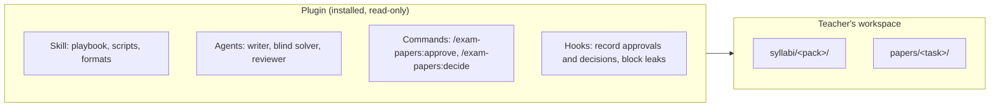
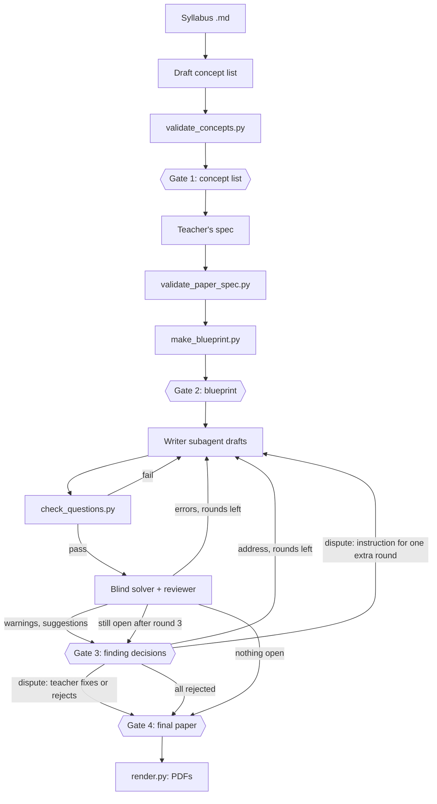

# Architecture

How the exam-papers plugin is put together, and the path a paper takes from syllabus to PDFs. Each
part is described in [harness-design.md](harness-design.md).

## Plugin and workspace

The plugin is installed read-only. Everything a teacher makes (syllabus packs, papers, approvals)
lives in their own workspace folder.

## From syllabus to PDFs

Scripts check every step; the teacher passes four gates by typing a command ([teacher gates](harness-design.md#teacher-gates)). The review
part of this flow is drawn in more detail in [review-loop.md](review-loop.md).

