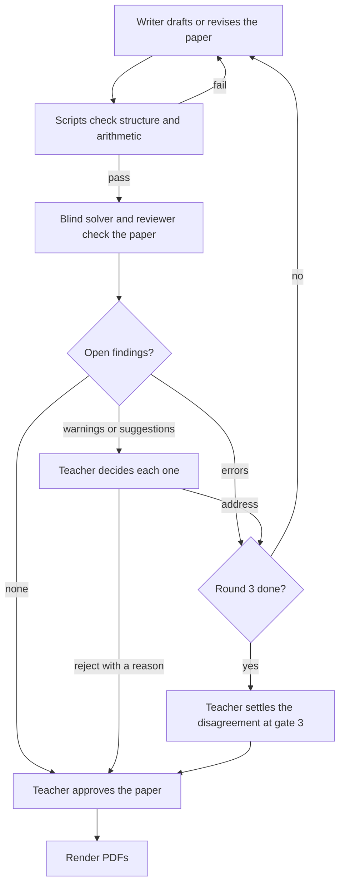
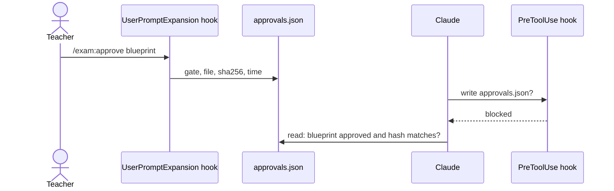
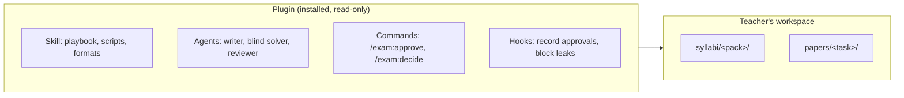
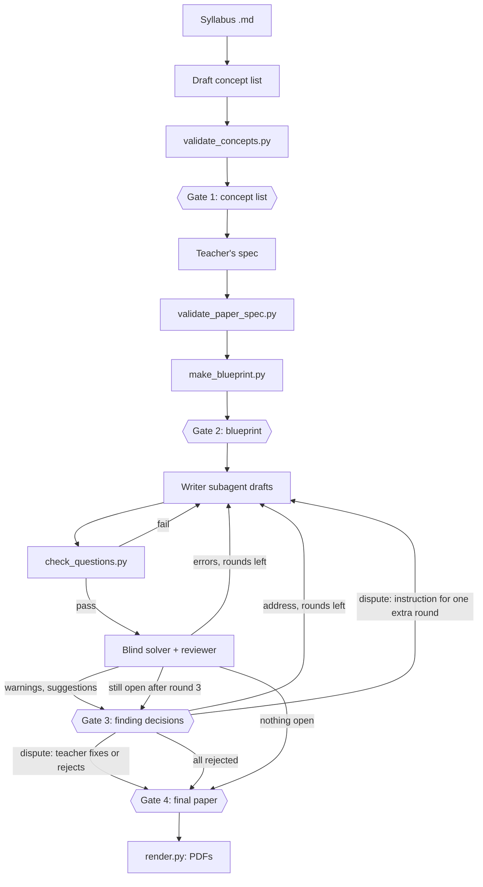

# Harness design

The goal, the architecture and every decision taken for the exam-paper harness, with the reason for
each. Decisions are numbered (D1, D2, ...) and never renumbered; a changed decision is marked
superseded and points to the one that replaces it.

## Goal

> Given **any syllabus** (and optionally the textbook's chapter map) plus a **paper spec**, produce a
> question paper and answer key as PDFs that are correct, on-syllabus and balanced as the spec asks.
>
> **Every generated artifact is checked before a teacher sees it**: the questions, the answer key, the
> marking scheme and the rendered PDFs. Structure and arithmetic are checked by deterministic code.
> Correctness, clarity and syllabus fit are checked by reviewers independent of the writer.
>
> **Review findings go back to the writer, who revises the paper.** Every revision is checked again,
> by the scripts and by the reviewers, until it passes or a round limit is reached. Each finding ends
> up fixed, or rejected with a reason, and the teacher can see which.
>
> A teacher approves at defined points, and the process is repeatable, auditable and measurably good.

## Harness layers

A harness is everything around the model that makes its work reliable. These are the layers this
design has to cover.

| Layer | Question it answers |
|---|---|
| Orchestrator | Who decides what happens next? |
| State | What is done, and is it still valid? |
| Tools | What deterministic work exists (validators, blueprint, checker, renderer)? |
| Agents | Which model roles exist, and what can each see and do? |
| Guardrails | What is enforced, not just asked for? |
| Human in the loop | Where must a teacher decide? |
| Observability | What happened in a run? |
| Evals | Is quality getting better or worse across runs? |
| Domain packs | How does a new syllabus or subject plug in? |

## Decisions

### D1. Review findings are handled by severity

- **Error** (the key is wrong, or a question cannot be answered or has more than one correct answer):
  the writer fixes it without asking the teacher.
- **Warning** and **suggestion**: the teacher decides, per finding, whether the writer addresses it.

*Why:* nobody wants a wrong answer key shipped, so asking about errors wastes the teacher's attention;
warnings and suggestions are matters of judgement that belong to the teacher.

### D2. The reviewer sets severity; automatic fixes stay visible

The reviewer labels each finding's severity. Every fix made without asking is listed for the teacher
with the finding, the change and the result of the re-check, and the teacher can reverse it.

*Why:* a reviewer can label a matter of taste as an error; visibility keeps the teacher in control
without making them approve each error fix.

### D3. At most 3 write–review rounds

If a finding is still open after three rounds, it goes to the teacher as a disagreement, with the
writer's and the reviewer's positions side by side. The teacher settles it at gate 3 (D7) in one of
three ways:

- give the writer a specific instruction for one extra round;
- fix it themselves;
- reject the finding, with a reason.

*Why:* write–review loops can bounce forever when the writer and reviewer disagree; a cap hands the
dispute to a person.

### Review loop (D1–D3)

### D4. The host app is the harness; we configure it rather than write our own loop

Claude Code (or Cowork) runs the loop: it calls the model, runs tools, starts subagents and fires
hooks. This project supplies the parts it runs:

| Part | Role |
|---|---|
| Skill (`SKILL.md`) | The playbook: the steps and the rules |
| Scripts | Deterministic tools: validate, plan, check, compare, render |
| Agents | Independent roles: blind solver, reviewer |
| Hooks | Enforcement: block actions that break the rules |

The user starts a paper by invoking the skill with a spec and a syllabus; nothing else to set up.

*Why:* teachers should not need an API key or a Python orchestrator to run. Trade-off accepted: the
model still chooses to follow the playbook. Hooks can block a wrong action (the solver reading the key,
a write before approval) but cannot force the right next action. A Python orchestrator using the Claude
Agent SDK stays possible later for batch or headless runs.

### D5. Ship as one plugin for Claude Code and Cowork; claude.ai chat is not supported

The skill, scripts, agents and hooks are packaged as one plugin, installed from a Git marketplace (or a
zip upload in Cowork).

*Why:* both Claude Code and Cowork load skills, agents and hooks. claude.ai chat ignores agents and
hooks, so its "blind" solver would be the same conversation that wrote the key, which breaks the goal's
independent review.

Rule that follows: scripts live inside the skill folder, never in a top-level `bin/` (a `bin/` folder
makes Cowork refuse the whole plugin).

### D6. Approvals come only from a command the teacher types

The teacher approves by typing a command such as `/exam:approve blueprint`. A `UserPromptExpansion`
hook (code that runs when a command the user typed expands, before Claude sees it) records the approval
in the task's `approvals.json`: which gate, which file, the file's SHA-256 hash and the time. It records
only when `command_name` is the plugin's approve command, `command_source` is `"plugin"` and there is
no `agent_id`. A `PreToolUse` hook blocks Claude from
writing `approvals.json`. A gate counts as passed only while the approved file still has the recorded
hash, so editing an approved file voids its approval.

*Why:* trust comes from where an action originates. Only a command the teacher types expands, so
Claude and its subagents cannot create an approval; the hash ties the approval to the exact content
the teacher saw.

*Not `UserPromptSubmit`* (the first version of D6): it also fires for subagent hand-backs, messages
from other sessions and scheduled tasks, with nothing in its input saying which. The probe showed a
subagent's reply arriving through it as `<agent-message …>` text, so a hook that read approvals from
`UserPromptSubmit` could be fooled by a subagent that writes `/exam:approve` in its reply.

*Limit:* this guards against mistakes, not a determined adversary. A `PreToolUse` hook can match
`Write`/`Edit` on the file exactly, but a Bash command can only be pattern-matched, so a creative
command could still slip through.

### D7. Four approval gates

Each gate is passed only by a typed command (D6).

| Gate | When | What the teacher approves |
|---|---|---|
| Concept list | Once per book, after `validate_concepts.py` passes (and once per paper in cloud Cowork, D18) | The concepts drafted from the syllabus |
| Blueprint | Every paper, before any wording is written | Chapter, concept, marks, kind and difficulty of every part |
| Finding decisions | After each review round with warnings or suggestions, and for any finding still open after round 3 | Accept or reject each warning and suggestion (errors are fixed without asking, D1); settle each disagreement (D3) |
| Final paper | After review ends, before the PDFs are rendered | The reviewed questions and key, and the list of automatic fixes (D2) |

The spec is not a gate: the teacher writes it, and `validate_paper_spec.py` checks it.

*Why:* each gate sits where a teacher's judgement is needed and a mistake would be costly to undo
later. The final gate is new: today nothing asks the teacher to sign off the finished paper.

### D8. First-version scope: science, maths and theory-only subjects

Beyond ICSE Class 9 Physics, the first version covers other science and maths subjects (numericals,
units, formulas, diagrams) and theory-only subjects (for example history, geography, languages). Maths
notation is handled by LaTeX (D10). Other boards and classes are not in the first version.

*Why:* science and maths are closest to what already works; theory-only subjects test whether the
design really generalises (no numericals, different question types, judgement-based marking).

### D9. A syllabus arrives as Markdown or plain text

The teacher supplies the syllabus as a Markdown or text file. PDF extraction is not in the first
version.

*Why:* it keeps text extraction and clean-up out of scope, so the work goes into drafting and checking
the concept list.

### D10. Maths notation is written in LaTeX

Question, answer and option text may contain LaTeX maths (for example `$\frac{a}{b}$`), which the
renderer turns into proper notation in the PDF. The HTML-style markup (``, ``, `<b>`, `<i>`)
stays for simple cases.

*Why:* stacked fractions, roots and equations look wrong in HTML-style markup, and maths is in scope
(D8).

### D11. Chapters are the syllabus's own units

A concept list is organised by the syllabus's units or sections, and a spec selects units. The book
becomes optional information.

*Why:* syllabi arrive without a book's contents (D9), so units are the only structure every syllabus
has. Consequence: the existing ICSE Physics list is organised by Selina book chapters (syllabus unit 4
"Fluids" is book chapters 4 and 5) and has to be moved to syllabus units.

### D12. Syllabus packs and papers live in the teacher's workspace

The plugin holds only code, prompts and formats. Everything a teacher makes lives in their workspace
(the project folder in Claude Code, the attached folder in Cowork):

- `syllabi/<pack>/`: `syllabus.md`, `concepts.json`, approvals;
- `papers/<task>/`: spec, blueprint, questions, `review/`, `approvals.json`, PDFs.

*Why:* an installed plugin is a cache that should not be written to, and Cowork can only write to
attached folders. The teacher owns and can see everything.

### D18. In cloud Cowork, one task makes one paper

Where hooks run in a sandbox that ends with the task (Cowork on Pro and Max plans, and on Team and
Enterprise when cloud sessions are on), a paper is made from start to finish in one task. Approvals,
`state.json` and `run.log` are trusted only inside that task. At the end, the whole paper folder (PDFs,
spec, blueprint, questions, review, `approvals.json`, `state.json`, `run.log`) is delivered to the
teacher's folder as a record. A new task starts a new paper. Syllabus packs are read from the teacher's
folder and checked again with `validate_concepts.py` in every task.

Where hooks run beside the teacher's folder (Claude Code on their computer, local Cowork), D12 applies
as written and a paper can span several sessions.

*Why:* Anthropic's Cowork architecture article says cloud sessions run in a sandbox that is "destroyed
when it ends", and that Cowork runs in the cloud on Pro and Max plans. The probe showed hooks writing
inside that sandbox. A file Claude copies out and back in is a Claude action, which D6 does not trust,
so trust cannot carry from one cloud task to the next. Which plans teachers will use is not known yet,
so the design has to work in the cloud case.

Each cloud task also re-approves the concept list: before the blueprint, it shows the list's summary
and hash and asks for a typed `/exam:approve concepts`. The record delivered from an earlier task is
shown for reference only.

*Why re-approve:* the earlier record is a copy Claude wrote into the teacher's folder; a changed list
together with a changed record would pass a hash check. One typed command per paper keeps D6's rule
that only typed commands create trust.

### D13. A writer subagent drafts and revises the questions

Main Claude only orchestrates: it runs the steps, talks with the teacher and passes work between roles.
A writer subagent drafts `questions.json` from the approved blueprint and revises it for accepted
findings.

*Why:* clear roles and smaller contexts, and each role's tools and file access can be set separately
(the writer never needs the solver's answers; the solver never sees the key).

### D14. State is a hash ledger plus a run log

- `state.json` in each task folder records every finished step with the SHA-256 hashes of its inputs
  and outputs. A step is done only while those hashes still match the files; changing an input makes
  that step and every step after it due again.
- `run.log` is an append-only record of every step, script result, agent call, approval and automatic
  fix, with times.

*Why:* file timestamps break on a copy, a `git checkout` or any re-save (re-printing the review findings
once sent a finished paper back to an earlier step). Hashes depend only on content. The log gives the
teacher an audit trail (D2) and gives the evals their data (D17).

### D15. Each syllabus pack declares its own kinds

The concept list declares the subject's kinds (Physics: `numerical`, `theory`; History, for example:
`recall`, `explanation`, `source_analysis`), and the spec balances on those. Difficulty (easy, medium,
hard) stays common to all subjects.

*Why:* it matches each subject's real exam pattern, and the scripts stay generic: they read the list of
kinds instead of knowing about numericals.

### D16. No new question formats in the first version

The formats stay MCQ, and short and long answers with parts. Theory subjects use these: a source or
passage can go in a question's `stem`, with parts that refer to it.

*Why:* keeps the first version's work on the harness itself. Source-based questions, essays with
rubrics, and fill-in or match items can be added later.

### D17. Evals: planted errors, run metrics and golden papers

- **Planted errors:** inject known mistakes into a known-good paper (wrong key, unanswerable question,
  off-syllabus part, marking that does not add up) and measure how many the solver and reviewer catch.
- **Run metrics:** from `run.log`: check failures, solver mismatches, findings by severity, rounds
  used, automatic fixes, and findings the teacher rejected.
- **Golden papers:** a fixed set of syllabi and specs rerun after every change to the prompts or
  scripts, with their metrics compared to the previous run.

*Why:* unit tests check the scripts, not the agents. Planted errors show whether review works; run
metrics and golden papers show whether a change made things better or worse.

### D19. Plugin name, repo layout, sample pack and dev loading

- **Name:** `exam-papers`. It is permanent and prefixes everything: the skill is
  `/exam-papers:make-paper`, the agents are `exam-papers:blind-solver` and `exam-papers:reviewer`, and
  the approve command will be `/exam-papers:approve`.
- **Layout:** the repo is a marketplace (`.claude-plugin/marketplace.json`) listing one plugin,
  `plugins/exam-papers/`. Tests, docs and examples stay in the repo and are not installed.
- **Paths:** the skill names its own files as `${CLAUDE_SKILL_DIR}/…` and runs every command from the
  teacher's workspace. Agents get every path they need in their prompt (the docs do not say that
  `${CLAUDE_SKILL_DIR}` works inside agent files).
- **Sample pack:** the ICSE Class 9 Physics (Selina) pack ships read-only in the skill, under
  `assets/syllabi/`. The skill copies it into the workspace's `syllabi/` only when the teacher agrees
  (D12: packs a paper uses live in the workspace).
- **Development:** the plugin is installed from this repo's own marketplace, so names and loading
  match what teachers get. A plugin installed from a local folder is read in place, so edits take
  effect after `/reload-plugins`.

*Why:* a permanent name that is specific but short to type at every gate; only the plugin ships; one
sample pack lets a teacher try a paper without writing a concept list first.

### Architecture

### Facts behind D4 and D5 (checked 2026-10-28)

From Anthropic's [plugin platform-support page](https://claude.com/docs/plugins/platform-support.md):

| Plugin part | claude.ai chat | Cowork | Claude Code |
|---|---|---|---|
| Skills | Loads | Loads | Loads |
| Commands | Loads as a skill | Loads (`/plugin:cmd`) | Loads |
| Agents | Ignored | Loads | Loads |
| Hooks (`hooks/hooks.json`) | Ignored | Loads | Loads |
| Top-level `bin/` | Plugin refused | Plugin refused | Loads |

### Probe results (2026-10-28)

A throwaway plugin (`probe`) tested what the docs leave open. It ran in a Cowork task, which ran in a
cloud workspace (`/home/claude`, Linux, Python 3.13) linked to the desktop app, not on the user's Mac.
The raw `probe-hook.log` confirms every result below. The Claude Code baseline has not run.

| Test | Result |
|---|---|
| Plugin hooks fire | Yes: `PreToolUse`, `UserPromptSubmit`, `UserPromptExpansion`, `SubagentStart`, `SubagentStop` |
| A hook can block a subagent's file read | Yes. Hook input inside a subagent has `agent_id` and `agent_type` (`probe:solver`), so the solver's calls can be told apart |
| A plugin agent's `tools` list is enforced | Yes: Grep, Edit and Bash were "not available" to an agent limited to Read and Write |
| A hook can block Claude's writes to a file | Yes, for Write and for a Bash `echo … >` |
| A typed plugin command triggers | `UserPromptExpansion` with `command_name: "probe:approve"`, `command_source: "plugin"` (recorded the approval) |
| A subagent's reply `/probe:approve …` triggers | `UserPromptSubmit` only, as `<agent-message …>` text; no `UserPromptExpansion`, so no forged approval |
| `reportlab` and `matplotlib` | Already installed (5.0.1, 3.11.2); pip works |
| Plugin agent names | Prefixed with the plugin name: `probe:solver` |

Also seen:

- `UserPromptSubmit` text is not what the user typed: the app puts `<system-reminder>` text in front
  of it, so even the user's own `/probe:approve` did not start with the command.
- The Bash guard denied a harmless `ls -la approvals.json 2>&1; cat approvals.json`, because `2>&1`
  contains `>` (pattern matching gives false alarms as well as misses; see D6's limit).
- Every subagent ends with a `SubagentHandback` tool call, which `PreToolUse` sees with the subagent's
  `agent_id`.

Problem found: **files and hooks live in the cloud workspace, not the teacher's folder.** Hooks ran
in `/home/claude` and wrote `approvals.json` and their logs there. The user's picked folders were
reachable only by Claude copying files across, and the files reached the Mac only when Claude sent
them. So approvals, `state.json`, `run.log`, syllabus packs and papers would be lost when the workspace
goes, and copying them to the teacher's folder is a step Claude performs, which D6 does not trust.
This affects D6, D12 and D14 for Cowork tasks that run in the cloud.

Still to find out:

- ~~whether a Cowork task can run on the user's computer~~: answered by D18 (plan and admin settings
  decide; Pro and Max are cloud only);
- whether a cloud workspace survives between turns of the same task (the article says the sandbox is
  destroyed when the session ends);
- the same probe in a Claude Code session on the Mac (baseline).

## Open questions

None at present. Questions answered so far: who drives the loop (D4, D5), first-version scope (D8),
syllabus input (D9), approvals (D6), gates (D7), state (D14), question kinds (D15), formats (D16),
evals (D17).
