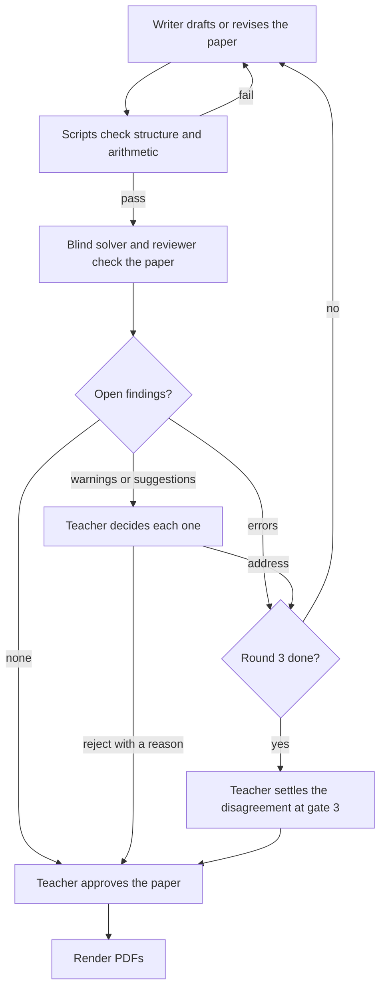

# Review loop

How a drafted paper is checked and revised until it is ready for the teacher's final approval. The
whole path from syllabus to PDFs is in [architecture.md](architecture.md); the scripts, hooks and
agents named here are described in [harness-design.md](harness-design.md).

## Rules

- **Scripts first.** The writer runs `check_questions.py` itself and fixes structural errors before
  handing back, so a script failure never uses up a review round.
- **The reviewer sets each finding's severity** and judges every mismatch from the blind solver:
  each becomes a finding, or is dismissed with a reason. The writer never sees the solver's answers.
- **Errors** (a wrong key, a question that cannot be answered or has more than one correct answer)
  are fixed by the writer without asking. **Warnings and suggestions** go to the teacher, who
  accepts or rejects each with `/exam-papers:decide`.
- **The writer answers every finding** in `review/writer-response.json`: `fixed`, with the change,
  or `disagree`, with its evidence.
- **Rounds 2 and on:** the reviewer gets its earlier findings, the writer's responses and what
  changed; it marks each finding `resolved` or `open` and reviews only the changed parts. Finding ids
  stay the same across rounds.
- **At most 3 rounds.** A finding still open after round 3 is a dispute, shown with the writer's and
  the reviewer's positions side by side. So is a finding the writer disagreed with that the reviewer
  keeps open, at once, since another automatic round would only repeat it. The teacher settles a
  dispute with the same command: `accept` gives the writer one more round with their instruction,
  `reject` leaves the paper as it is (to fix it themselves, they edit `questions.json`, then reject).
- **Automatic fixes stay visible.** At the final approval, `review_status.py --fixes` lists every
  change made without asking, round by round, with the text before and after, and any change no
  writer response accounts for. The teacher can undo a fix with `/exam-papers:decide reject ID`; the
  writer restores the text and a new round checks it.
- **Rounds are counted** from `review/rounds.json`, which `review_status.py --close-round` appends to
  after each review, saving that round's questions, report and writer response in `review/rounds/N/`.
